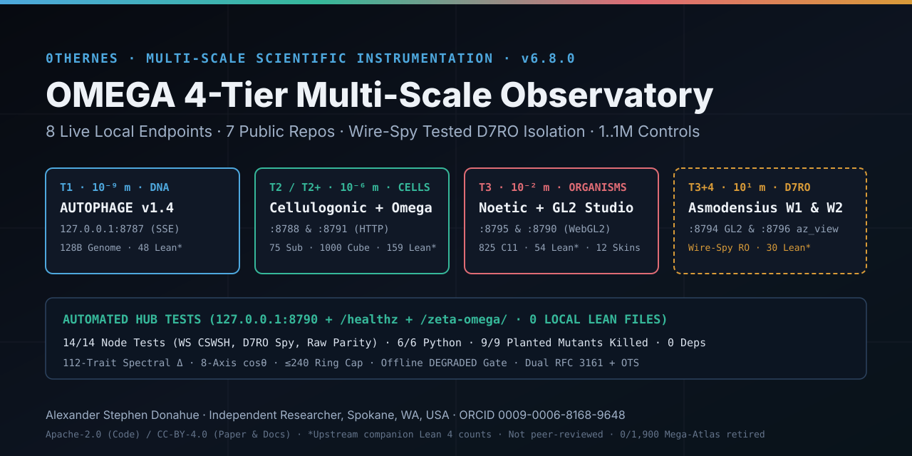

# OMEGA 4-Tier Multi-Scale Observatory (v6.8.0)

Unified zero-dependency Node.js ESM, Python 3, and WebGL 2.0 multi-scale Artificial Life cockpit supervising **8 live local endpoints across 7 public repositories** on `http://127.0.0.1:8790/` with render-only `D7RO` observer isolation (checked via display matrix assertions, `#ifdef PICK` preservation, and a live loopback wire-spy test), loopback HTTP CSRF & live raw-socket WebSocket `Upgrade` `403` CSWSH guards, bounded `1..1,000,000` bare-metal controls differentially verified on raw unnormalized inputs between Node and Python, and `9/9` hand-planted regression mutants killed (`7` in `lib/observatory_core.mjs`, `2` in `server.mjs`).

[](VERSION)
[](ROADMAP.md)
[](LICENSE)
[](LICENSE-DOCS)
[](tests/test_observatory.mjs)
[](results/mutation_audit.json)
[](repo.yaml)

> **PREPRINT & PEER-REVIEW NOTICE:** This software artifact and its accompanying technical architecture white paper ([`dist/Donahue_2026_omega_triscale_observatory.pdf`](dist/Donahue_2026_omega_triscale_observatory.pdf)) have **not undergone external peer review**.  
> **Maintenance status:** `status: active` · **Author:** Alexander Stephen Donahue (`Independent Researcher, Spokane, WA, USA`, ORCID [`0009-0006-8168-9648`](https://orcid.org/0009-0006-8168-9648)) · **Showcase:** [`https://0thernes.github.io/omega-triscale-observatory/`](https://0thernes.github.io/omega-triscale-observatory/) · **SWHID:** `swh:1:snp:045edd61e0805b3778e40f5230062e8cc245bb60`



## Supervised 4-Tier, 8-Endpoint Topology (7 Public Repositories)

| # | Tier / Instrument | Biological & Computational Layer | Upstream Engine & Audits | Local Endpoint |
|---|---|---|---|---|
| **#1** | **Tier 1 · DNA (`10⁻⁹ m`)** | 256B x86-64 RWX Genomes, 8×8 F₂ Ribosomes, GF(2⁸), Real 128B Genome Export, Philox/Weismann Isolation | `AUTOPHAGE v1.4.0` (`0thernes/autophage` · 48 upstream Lean 4) | `http://127.0.0.1:8787/` |
| **#2** | **Tier 2 · CELLS (`10⁻⁶ m`)** | True 3D Morphogens, Strict 4-Solvent Second Law, XPBD Dissipation, Carcass/Yolk Conservation, 128B DNA Ingest | `Cellulogonic Mecha v1.5.0` (`0thernes/cellulogonic-mecha` · 70 upstream Lean 4) | `http://127.0.0.1:8788/` |
| **#3** | **Tier 2+ · DEEP STRATA & CUBE** | 16 Frontier Testbeds (`TB01`–`TB16`), 75 Substrates, 1,000-Cell Hybrid Cube | `Cellular Engine Omega v5.2.0` (`0thernes/cellular-engine-omega` · 89 upstream Lean 4) | `http://127.0.0.1:8791/` |
| **#4** | **Tier 3/4 · COGNITIVE & CS-v3** | 825/825 Native C11 Checks (29 indicator-only, 5 classical-parity disclosed), 100 Milestones, 13 CS-v3 Gates | `Noetic Organism Omega v2.1.0` (`0thernes/noetic-organism-omega` · 54 upstream Lean 4) | `http://127.0.0.1:8795/` |
| **#5** | **Tier 3+4 · ASMODENSIUS WORLD #1** | GPU WebGL2 3D Wild Cosmos (`macro_wild_relay.py`), Orbit/Dive, Voxels, Close-Ups, strict **`D7RO`** read-only | `Asmodensius-Native v1.1.0` (`0thernes/asmodensius-native` · 30 upstream Lean 4) | `http://127.0.0.1:8794/` |
| **#6** | **Tier 3+4 · ASMODENSIUS WORLD #2** | Native `az_view` Live Dashboard & Proof Bench (`live_server.py`, toggleable via `W1:GL2` ⇄ `W2:az_view`) | `Asmodensius-Native v1.1.0` (`az_live.exe` + `az_run.exe`, **`D7RO`**) | `http://127.0.0.1:8796/` |
| **#7** | **ALL 4 TIERS · MASSIVE HUB v6.8.0** | Unified Cockpit, 112-Trait Spectral Δ, 8-Axis `cosθ`, `<=240` Ring, Bare-Metal `1..1M` Studio, `/healthz` | `server.mjs` + `lib/observatory_core.mjs` (this repository) | `http://127.0.0.1:8790/` |
| **#8** | **ZETA-OMEGA v3.4.0 ATLAS** | 21-Tab Static Archive (2,782 records, 18/18 upstream package forensic gates, 36 upstream Lean 4) | `alife-singularity-omega-package v3.4.0` via safe static proxy | `http://127.0.0.1:8790/zeta-omega/` |

## Quickstart

Requires **Node.js >= 22** and **Python >= 3.12** (zero `npm install` or `pip install` needed).

```bash
git clone https://github.com/0thernes/omega-triscale-observatory.git
cd omega-triscale-observatory

# 1. Run all automated verification, wire-spy, raw-socket WS CSWSH, property, differential, lint, mutation & timestamp checks
npm test
python -m unittest discover -s tests -v
npm run lint
npm run mutate
python scripts/stamp_timestamps.py --verify

# 2. Launch standalone UI & health endpoint (no sibling repositories required)
npm run start:standalone
# Visit http://127.0.0.1:8790/ and http://127.0.0.1:8790/healthz

# 3. Launch full 4-tier 8-endpoint supervisor (when companion repos are cloned as siblings)
npm start
```

## Usage

### Dry-Run Bare-Metal Relay CLI (Cross-Platform, Safe)

```bash
python macro_wild_relay.py --preset million --data-dir ./runtime/dry \
  --n 1000000 --cap 0 --species 100 --kernels 1 --ecores --gpu 1 --prefetch 1 --large-pages --dry-run
```

### Programmatic Core Import (`lib/observatory_core.mjs`)

```js
import { normalizeGenesisConfig, buildRelayArgs, computeDifferentialsCore, createInitialState } from "./lib/observatory_core.mjs";

const cfg = normalizeGenesisConfig({ preset: "million", n: 1_000_000, ecores: true, gpu: true, prefetch: true });
console.log(cfg.n, cfg.cap, buildRelayArgs(cfg).includes("--ecores"));
// -> 1000000 1004096 true
```

See [`examples/README.md`](examples/README.md) and [`examples/verify_pipeline.mjs`](examples/verify_pipeline.mjs) for runnable end-to-end examples.

## Honest Verification Boundaries & Mega-Atlas Cross-Check

- **Local vs. Upstream Proofs:** This repository contains **0 local Lean 4 files**. It is strictly an orchestration, reverse-proxy, and visualization instrument. Its own invariants are checked by **14/14 Node tests** (including live raw-socket WebSocket `Upgrade` `403`/`101` CSWSH tests, live loopback `D7RO` wire-spy test recording every request sent to a mock Asmodensius server during T1/T2 updates, offline-engine `DEGRADED` conservation gate tests for `t1_dna`/`t2_cells`/`t4_env`, **250 seeded `prop_check` trials**, and **18 raw unnormalized adversarial Node↔Python differential parity cases**), **6/6 Python relay tests** (**120 trials**), static lint (`9` JS/MJS + `5` Python targets, `0` errors), and **9/9 hand-planted regression mutants killed** (`7` in `lib/observatory_core.mjs`, `2` in `server.mjs`; default `npm run mutate` does not dirty `results/mutation_audit.json`). These are example-based, live-socket, differential, and seeded-random tests, not formal proofs or an exhaustive repo-wide mutation score. Remaining scope boundaries (e.g., absent-`Origin` loopback CLI admission, mock vs. live native binaries) are documented transparently in [`LIMITATIONS.md`](LIMITATIONS.md) and [`CLAIMS.md`](CLAIMS.md). The `327` combined 6-kernel Lean 4.35.0 proofs referenced in the ecosystem header live in, and are reported by, their six respective formal sibling repositories (`48 + 70 + 89 + 54 + 30 + 36`); they are not audited here.
- **Unsolved Problems Mega-Atlas Non-Retirement:** **`0 / 1,900` overarching Mega-Atlas open problems are solved or retired** by this repository. It serves solely as an observation and orchestration instrument supporting empirical study of `AI-045`, `SYS-009`, and `SYS-050`, each of which remains strictly **OPEN** (see [`docs/MEGA_ATLAS_CROSSCHECK.md`](docs/MEGA_ATLAS_CROSSCHECK.md)).
- **Statement Audit & v6.8.0 Resolutions (2026-11-26):** Every wording, bibliography (`bedau1998`), CI SLSA attestation, code, UI, and test-coverage gap logged by the independent statement audit ([log](https://github.com/0thernes/0thernes-research-archive/blob/main/docs/reviews/2026-11-26-statement-audit.md)) is preserved and resolved transparently in [`ERRATA.md`](ERRATA.md).
- **Limitations & Indicator-Only Disclosures:** See [`LIMITATIONS.md`](LIMITATIONS.md) and [`CLAIMS.md`](CLAIMS.md) for full real-vs-metaphor boundaries (e.g., `chaosLyapunov` is a heuristic volatility index, not a maximal Lyapunov exponent; Tier 3 internal organs are count-driven projections; this preprint is not externally peer-reviewed).

## AI-Contribution Disclosure & CRediT Authorship

- **Sole Human Author:** Alexander Stephen Donahue — Independent Researcher, Spokane, WA, USA · ORCID [`0009-0006-8168-9648`](https://orcid.org/0009-0006-8168-9648) · `0_0@0thernes.art`
- **CRediT Roles:** Conceptualization, Methodology, Software, Validation, Investigation, Data Curation, Writing — Original Draft, Writing — Review & Editing, Supervision.
- **Transparent AI Disclosure:** Large language model coding assistants were used under direct human architectural direction to refactor pure modules, author test/mutation/citation harnesses, draft AMS-LaTeX and documentation prose, and execute automated Build Standard audits. Every test pass (`14/14` Node, `6/6` Python), planted-mutant kill (`9/9`), Crossref/DataCite citation audit (`13/13`), dual RFC 3161 + Bitcoin OTS timestamp, Tectonic PDF compilation, and GitHub Actions CI run was executed directly against committed files and reviewed by the human author (full disclosure in [`docs/AI_DISCLOSURE.md`](docs/AI_DISCLOSURE.md)). Competing interests: none declared.

## Documentation, Paper & Archival Provenance

- **Interactive Showcase (GitHub Pages):** [`https://0thernes.github.io/omega-triscale-observatory/`](https://0thernes.github.io/omega-triscale-observatory/) (`docs/index.html`, WCAG 2.2 AA, strict CSP, zero CDN)
- **White Paper (AMS-LaTeX PDF):** [`dist/Donahue_2026_omega_triscale_observatory.pdf`](dist/Donahue_2026_omega_triscale_observatory.pdf) · Source: [`paper/main.tex`](paper/main.tex) · Clean-room arXiv tarball: [`dist/arxiv_submission.tar.gz`](dist/arxiv_submission.tar.gz) *(not externally peer-reviewed)*
- **Verification & Governance:** [`CLAIMS.md`](CLAIMS.md) · [`LIMITATIONS.md`](LIMITATIONS.md) · [`ERRATA.md`](ERRATA.md) · [`REPLICATION.md`](REPLICATION.md) · [`SUBMISSION_READINESS.md`](SUBMISSION_READINESS.md) · [`docs/DATASHEET.md`](docs/DATASHEET.md) · [`docs/index.md`](docs/index.md)
- **Cryptographic & FAIR Provenance:** [`CHECKSUMS.sha256`](CHECKSUMS.sha256) · [`CHECKSUMS.sha256.tsr`](CHECKSUMS.sha256.tsr) (DigiCert RFC 3161) · [`CHECKSUMS.sha256.ots`](CHECKSUMS.sha256.ots) (Bitcoin OpenTimestamps) · [`data/MANIFEST.sha256`](data/MANIFEST.sha256) · [`croissant.json`](croissant.json) · [`ro-crate-metadata.json`](ro-crate-metadata.json) · [`codemeta.json`](codemeta.json) · [`REUSE.toml`](REUSE.toml)
- **Dual License:** Code under [Apache-2.0](LICENSE) · Paper, Docs & Figures under [CC-BY-4.0](LICENSE-DOCS)
